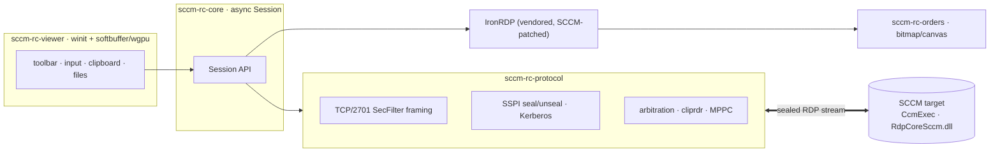

> **Downstream distribution.** This repository is a downstream of
> [conocidotech/sccm-rc-viewer](https://github.com/conocidotech/sccm-rc-viewer)
> with **macOS support**, maintained by Monads AG. It is not affiliated with
> Conocido or Microsoft. Signed macOS builds are on this repository's
> *Releases* page; for Windows releases see upstream. Report macOS issues here;
> issues that also occur on Windows belong upstream. Changes made here are
> offered back to upstream as pull requests.

<h1 align="center">sccm-rc</h1>

<p align="center">
  <strong>A modern, pure-Rust viewer for SCCM ConfigMgr Remote Control.</strong><br>
  Encrypted &amp; Kerberos-authenticated, with clipboard, file transfer, multi-monitor and GPU rendering —
  a drop-in alternative to Microsoft's <code>CmRcViewer.exe</code>.
</p>

<p align="center">
  <a href="https://github.com/conocidotech/sccm-rc-viewer/actions/workflows/ci.yml"></a>
  
  
  
  <a href="https://github.com/conocidotech/sccm-rc-viewer/releases/latest"></a>
</p>

<p align="center">
  <a href="https://github.com/conocidotech/sccm-rc-viewer/releases/latest"></a>
</p>

<p align="center">
  
</p>

---

`sccm-rc` re-implements the **operator-side viewer** of Microsoft's ConfigMgr
Remote Control (the ConfigMgr 2012-era ActiveX-hosting Win32 binary
`CmRcViewer.exe`). Targets keep running the existing SCCM client agent
(`CcmExec` / `RdpCoreSccm.dll`) unchanged — only the viewer is reimplemented.

It speaks the SCCM RC wire protocol directly: an SSPI-sealed (Kerberos/NTLM)
TCP/2701 stream carrying a standard RDP byte stream, decoded with a vendored,
SCCM-patched [IronRDP](https://github.com/Devolutions/IronRDP).

## Features

**🔒 Security**
- Every frame is **SSPI-sealed**; the client refuses unencrypted channels (fail-closed).
- **Kerberos mutual authentication** with a live security indicator (verifies the
  server holds the target's service key — the SSPI equivalent of a valid certificate).

**🖥️ Productivity**
- Bidirectional **clipboard** (MS-RDPECLIP `cliprdr`) and **file transfer**.
- **Multi-monitor**: view *all screens* of a multi-monitor target as one combined
  desktop (SCCM "All Screens", `--all-screens`), then switch to an individual screen
  on the fly from the toolbar or with **Ctrl+Tab** — instantly, no reconnect.
- Full keyboard/mouse control incl. Win-key passthrough, or **view-only**.

**🛠️ Operations**
- **Audit log** + optional **session recording**.
- **Curtain / privacy mode** and remote-input lock.
- **Wake-on-LAN**, dead-connection detection and automatic reconnect / host-switch.
- Pre-flight **prerequisite checker** that explains *which* requirement is missing.

**🎨 Rendering**
- Native window (`winit`) with a **software** (`softbuffer`) or **GPU** (`wgpu`)
  renderer, dirty-region uploads, and a crisp client-rendered cursor.

## Why this exists

| | Original `CmRcViewer.exe` | `sccm-rc` |
|---|---|---|
| HiDPI / multi-monitor | poor | ✅ |
| Error messages | cryptic, hide the real prerequisite | ✅ clear pre-flight diagnostics |
| Clipboard / file transfer | ❌ | ✅ |
| Audit / session recording | ❌ | ✅ |
| Bulk / host-switch workflow | ❌ | ✅ |
| Rendering | ActiveX host | ✅ native software/GPU |
| Footprint | legacy Win32 + ActiveX | ✅ single self-contained binary |

## Architecture



| Crate | Purpose |
|---|---|
| `sccm-rc-protocol` | TCP/2701 SecFilter framing, SSPI seal/unseal handshake, session arbitration, `cliprdr` clipboard, MPPC decompression |
| `sccm-rc-orders` | RDP drawing-order + bitmap decode and software canvas |
| `sccm-rc-core` | High-level async `Session` API; glues the protocol layer to IronRDP |
| `sccm-rc-diag` | Pre-flight prerequisite checker (TCP/2701, LSA/SCM/WMI); CLI + library |
| `sccm-rc-viewer` | Native viewer UI (rendering, toolbar, clipboard, file transfer, curtain, audit, recording) |

The on-wire format is documented in [`docs/SPEC.md`](docs/SPEC.md) and
[`docs/PROTOCOL.md`](docs/PROTOCOL.md), as observed from a live `CmRcViewer.exe`
session. `experiments/` holds the reverse-engineering tooling used to derive it.

## Quick start

**Just want to run it?** Download the prebuilt Windows binary from the
[latest release](https://github.com/conocidotech/sccm-rc-viewer/releases/latest),
extract, and run `sccm-rc-viewer.exe <host>`. To build from source:

Targets the `x86_64-pc-windows-gnu` toolchain (no admin / MSVC Build Tools needed).
The MinGW-w64 linker/`dlltool` comes from [WinLibs](https://winlibs.com/).

```powershell
# One-time setup
rustup toolchain install stable-x86_64-pc-windows-gnu --profile minimal
winget install --id BrechtSanders.WinLibs.POSIX.UCRT --scope user

# Build
. .\env.ps1                 # prepends rust + MinGW to $env:Path
cargo build --release
```

```powershell
# Connect the viewer to a target (prompts for a host if omitted)
cargo run --release -p sccm-rc-viewer -- TARGET-HOST

# All Screens (combined multi-monitor desktop; switch screens with Ctrl+Tab),
# plus Wake-on-LAN
cargo run --release -p sccm-rc-viewer -- TARGET-HOST --all-screens --wake --mac AA-BB-CC-DD-EE-FF

# Pre-flight prerequisite check (exit 0 = clear, 2 = blocker found)
cargo run -p sccm-rc-diag -- TARGET-HOST --json
```

**Saved targets.** Without a host argument the viewer opens a start screen
listing saved targets (by name) and recent ones; typing filters the list.
Ctrl+S (Cmd+S on macOS) saves the highlighted or typed host under a name, or
renames it; Ctrl+Del (Cmd+Delete) twice removes it. A saved name also works
as the host argument. The list is personal, stored in the viewer's data folder.
On macOS the start screen and the logon are native sheets (search field, list,
Save…/Rename…/Delete buttons, double-click to connect).

CI (`.github/workflows/ci.yml`) builds and tests the workspace on `windows-latest`
with the same gnu toolchain, and on `macos-26` (tests only; see below).

### macOS

The viewer also runs on macOS 15 or later (Apple Silicon and Intel), with a
native menu bar and the session controls in the title-bar toolbar
(`SCCM_RC_NATIVE_UI=0` brings back the drawn toolbar). A Mac is normally not
domain-joined, so there is no single sign-on: the viewer logs on with **NTLM**
using `DOMAIN\user` and a password, entered in the viewer window. NTLM cannot
verify the server's identity, so the toolbar shows an amber padlock
("NTLM · encrypted") instead of the green Kerberos one. The target must accept
NTLM for remote control.

Optionally, tick *Save password in Keychain* on the logon screen. The password
is stored in your login Keychain (item "SCCM RC logon", one per `DOMAIN\user`)
only after the logon succeeded, and filled in on the next logon. A logon the
server rejects deletes the saved item; untick the box to remove it yourself.

```sh
# One-time setup: Rust via https://rustup.rs (Xcode Command Line Tools for the linker)
cargo run --release -p sccm-rc-viewer -- TARGET-HOST   # asks for user + password

# Build "SCCM RC.app" and a .dmg in dist/ (universal = Apple Silicon + Intel)
packaging/macos/bundle.sh --universal --dmg
```

Keyboard: Cmd is sent to the remote as Ctrl (Cmd+C / Cmd+V work as expected);
set `SCCM_RC_CMD_AS_WIN=1` to send it as the Windows key instead. Ctrl+Alt+End
sends Ctrl+Alt+Del. Not available on macOS: copying *files* via the clipboard,
and the Windows-only checks of `sccm-rc-diag` (it reports them as skipped).

**Signing.** Apps you build yourself run without warnings. A downloaded `.dmg`
that is not signed with an Apple Developer ID and notarized is blocked by
Gatekeeper (macOS 15+: allow it once under *System Settings → Privacy &
Security → Open Anyway*). `bundle.sh` signs and notarizes when
`MACOS_SIGN_IDENTITY` and `MACOS_NOTARY_*` are set; `.github/workflows/release-macos.yml`
does the same for tagged releases when the maintainers provide those secrets in
the protected `release` environment. CI builds for pull requests are never
signed. Tags, setup and checks: [`packaging/macos/RELEASING.md`](packaging/macos/RELEASING.md).

## Letting Claude operate a till

`sccm-rc-mcp` is an [MCP](https://modelcontextprotocol.io) server. It gives
Claude Code (or any MCP client) a few tools to look at a till's screen and to
click and type on it. Claude sees the till as a picture and works like a person
at the keyboard. It has no access to the Windows system behind the screen:
no files, no shell, only what the remote-control session shows.

Headless mode builds and runs on macOS and Windows (the viewer's session code
is shared); live mode needs a Unix socket and runs on macOS and Linux. Build it
and register it with Claude Code:

```sh
cargo build --release -p sccm-rc-mcp

claude mcp add sccm-rc -- /path/to/sccm-rc-mcp --mode headless
# or, to watch along in the viewer:
claude mcp add sccm-rc -- /path/to/sccm-rc-mcp --mode live
```

`SCCM RC.app` from `bundle.sh` already contains the binary, at
`SCCM RC.app/Contents/MacOS/sccm-rc-mcp`. The mode is fixed in the
registration; there is no automatic switching.

**Headless mode** (the default) opens its own session, without a window. It
never asks for anything, so the logon data must already be there:

- User: `SCCM_USER` (`DOMAIN\user`, or a bare user plus `SCCM_DOMAIN`), else the
  user of the last explicit logon in the viewer.
- Password: the Keychain item the viewer saves ("Save password in Keychain",
  see macOS above; macOS only), else `SCCM_PASS`.

A logon the till rejects is not retried until the server is restarted, so a
wrong password cannot lock the account.

**Live mode** drives the viewer you are looking at. In the viewer, switch on
*Allow Control by Claude* (Control menu or toolbar; the switch is part of the
native macOS window chrome, so it exists only in the macOS viewer). Claude then
uses your open session, and you see what it does. You always win:

- A mouse click, the wheel or a key press from you interrupts the running
  command. Plain mouse moves do not.
- For 2 seconds after your last input, Claude's commands are refused
  ("user took over").
- The switch is off after every start of the viewer. While it is off, every
  tool answers that control is not enabled.

### Tools

Coordinates are pixels in the image of the most recent `screenshot`, or
fractions from 0 to 1 of the desktop with `relative: true`.

| Tool | What it does |
|---|---|
| `connect` | Headless: connect to a till by host name or IP (`target`); refuses if a user is logged on, unless `force: true`. Live: never dials a till; reports the viewer's session (and notes it if the viewer is connected to another till). |
| `disconnect` | Headless: release the till. Live: only hands control back; the viewer stays connected. |
| `screenshot` | PNG of the desktop, scaled down to `max_width` (default 1280). Optional `region` in desktop pixels. |
| `click` | Click at `x`, `y`. `button` left (default), right or middle; `double` for a double click. |
| `move` | Move the pointer without clicking, for hover effects. |
| `scroll` | Mouse wheel at `x`, `y`. `amount` in notches, positive up, negative down. |
| `type_text` | Type text, independent of the till's keyboard layout. `secret: true` for passwords. |
| `key` | Press a key or combination: `Enter`, `Esc`, `Tab`, `F5`, `Ctrl+A`, `Ctrl+Alt+Del`, `Num0` to `Num9`, `NumEnter`. |
| `batch` | Run several steps in order in one call. Steps are `click`, `move`, `scroll`, `type_text`, `key` and `wait`, with the arguments of that tool. Stops at the first failing step. No `screenshot`, `status`, `disconnect` or nested `batch` inside. |
| `wait` | Wait until the screen changes (`change: true`) and/or has stayed unchanged for `stable_ms`; gives up after `timeout_ms` (required, at most 5 minutes). At least one of `change` and `stable_ms` is required. |
| `status` | Connection state, target, desktop size, mode and idle time. In live mode the state of the viewer's session. |

### Safety

- **A till in use is left alone.** `connect` fails when a user is logged on,
  unless `force` is set; then the till is taken over from that user. If the
  till reports `ERROR_EXISTING_SESSION` (another remote-control session is
  active, perhaps your own viewer), it cannot be taken over. Try again later.
- **Idle timeout.** In headless mode a session with no tool call for 10 minutes
  is released.
- **Graceful release.** In headless mode `disconnect`, the end of the MCP
  connection (stdin closing), SIGINT, SIGTERM, SIGHUP (the terminal closed),
  SIGQUIT and the idle timeout all release the till. Only a hard kill
  (SIGKILL) leaves it occupied until the till times the session out. In live
  mode the session belongs to the viewer and is never released by the server.
- **Secrets stay out.** Text typed with `secret: true` is never logged and not
  echoed in the result or in error messages. The server logs to stderr only;
  stdout carries the protocol.
- **Audit log.** `connect`, `disconnect` and every action go to the viewer's
  `audit.jsonl` (on macOS in `~/Library/Application Support/sccm-rc/`), as
  entries with `"event":"agent"`. In headless mode the server writes them; in
  live mode the viewer does. Secret text is not recorded.

## Vendored IronRDP

`vendor/ironrdp-connector` is a patched copy of the crate (see
[`vendor/ironrdp-connector/SCCM-PATCHES.md`](vendor/ironrdp-connector/SCCM-PATCHES.md))
redirected via `[patch.crates-io]`. The patch allows standard RDP security
(`encryption = NONE`) because the SCCM SecurityFilter already seals every frame.
Its upstream MIT/Apache-2.0 licenses are preserved in that directory.

## Status & roadmap

Working and in active use; see [`docs/ROADMAP.md`](docs/ROADMAP.md) for what's done
and planned.

## Contributing

Contributions are welcome — see [`CONTRIBUTING.md`](CONTRIBUTING.md) for the build
setup, tests and style. Please be mindful of the [Code of Conduct](CODE_OF_CONDUCT.md).

## Security

This is a security-sensitive tool. Please report vulnerabilities privately via
the process in [`SECURITY.md`](SECURITY.md) rather than a public issue.

## License

Dual-licensed under either of [Apache-2.0](LICENSE-APACHE) or [MIT](LICENSE-MIT) at
your option. The vendored IronRDP code retains its own MIT/Apache-2.0 licenses.
